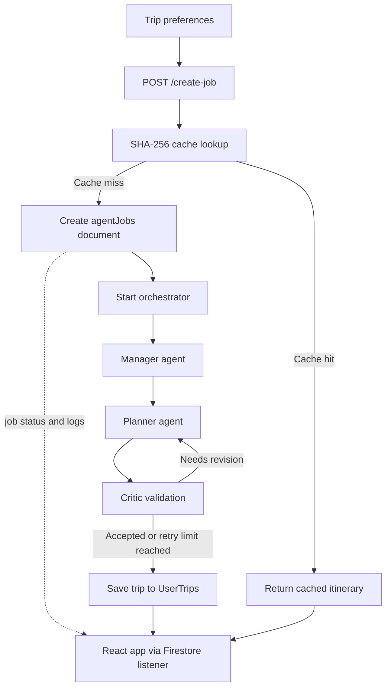

# vac-AI-tion

<p align="center">
  
</p>

<h3 align="center">Plan less. Explore more.</h3>
<p align="center">
  An AI-powered travel planner that turns trip preferences into editable, day-by-day itineraries — with live generation progress, route maps, and budget-aware planning.
</p>

<p align="center">
  <a href="https://vac-ai-tion.vercel.app"><strong>Open the app ↗</strong></a>
  &nbsp; · &nbsp;
  <a href="https://github.com/RythmaLakkady/vac-ai-tion">View source</a>
</p>

<p align="center">
  
  
  
  
</p>

---

## The experience

Start with the details that shape a trip — destination, duration, travelers, budget, and travel style. vac-AI-tion generates a structured itinerary, shows generation progress as it happens, and lets travelers refine the plan.

## What it does

| Plan | Explore | Make it yours |
|---|---|---|
| Generate multi-day trips from traveler preferences | View places and routes on an interactive map | Reorder activities across days with drag-and-drop |
| Account for budget, travel style, saved places, and trip details | Follow agent progress as the itinerary is generated | Update the itinerary after changing the schedule |

**More than a prompt and a response.** The generation flow uses a Manager → Planner → Critic sequence. The Manager outlines a trip strategy, the Planner structures the itinerary as JSON, and the Critic checks key constraints. Validation feedback can be sent back to the Planner for another attempt, up to a fixed retry limit.

## How generation works



The API creates a job record and responds to the client while the orchestrator runs. The frontend listens to the job document for status and progress updates. Repeated requests can be served from Firestore using a SHA-256 hash of normalized trip inputs.

## Built with

| Layer | Technologies |
|---|---|
| Frontend | React 18, Vite, Tailwind CSS, React Router |
| Interaction & maps | @hello-pangea/dnd, Leaflet, React-Leaflet, Framer Motion |
| Backend | Node.js, Express, Firebase Cloud Functions v2 |
| AI | Groq API — `openai/gpt-oss-120b` for itinerary orchestration; `openai/gpt-oss-20b` for chat and travel insights |
| Data & auth | Cloud Firestore, Firebase Authentication |
| Testing & delivery | Vitest, React Testing Library, ESLint, GitHub Actions |
| Hosting | Vercel (frontend), Render / Firebase Functions (API deployment paths) |

## Engineering decisions

- **Asynchronous generation:** Itinerary generation is separated from the browser's initial request. A job document tracks status and logs, and the UI receives updates through Firestore listeners.
- **Bounded planner–critic loop:** The orchestrator allows up to three planner attempts. The Critic checks duration, activity count, hotel/flight constraints, and JSON validity; its failure feedback is included in the next planning prompt.
- **Deterministic caching:** Destination, duration, budget, and traveler count are normalized and hashed with SHA-256. A matching cache entry avoids another generation run.
- **Location fallback:** Place search tries the backend autocomplete endpoint, then LocationIQ when a client key is configured, and finally OpenStreetMap Nominatim.
- **Graceful API routing:** `resolveFunctionUrl` prioritizes an explicit backend URL, supports the local Firebase Functions emulator when enabled, and otherwise falls back to the deployed API URL.

## Run locally

### Requirements

- Node.js 20+
- npm
- A Firebase project with Authentication and Firestore configured

### Setup

```bash
git clone https://github.com/RythmaLakkady/vac-ai-tion.git
cd vac-ai-tion
npm install
```

Create a `.env` file in the project root with the Firebase client key and API URLs:

```env
VITE_FIREBASE_API_KEY=your_firebase_web_api_key
VITE_FUNCTION_URL=https://vac-ai-tion.onrender.com
VITE_PRICE_FUNCTION_URL=https://vac-ai-tion.onrender.com

# Optional: direct browser-side LocationIQ fallback
VITE__LOCATION_IQ_API_KEY=your_locationiq_key

# Set true only when using the local Firebase Functions emulator
VITE_USE_LOCAL_EMULATOR=false
```

Keep Groq and Firebase Admin credentials in the backend environment (for example, Render or Firebase Functions configuration), not in `VITE_*` variables. Vite exposes `VITE_*` values in browser-facing assets.

Start the development server:

```bash
npm run dev
```

The app runs at `http://localhost:5173`.

### Checks

```bash
npm run lint
npm test -- --run
npm run build
```

## Current limitations

- Flight, hotel, and activity price comparisons use heuristic mock vendor estimates, not live booking-provider inventory.
- The cache key currently omits travel style and some personalization fields; equivalent cache hits can therefore ignore those differences.
- Public shared trips are read-only; collaborative multi-user editing and conflict resolution are not implemented.
- Map tiles and trip retrieval require an internet connection.

## Project

Built by **Rythma Lakkady**.

[GitHub](https://github.com/RythmaLakkady) · [LinkedIn](https://www.linkedin.com/in/rythma-lakkady-1725852a2/) · [Portfolio](https://rythmalakkady.vercel.app/)

[MIT License](LICENSE)
