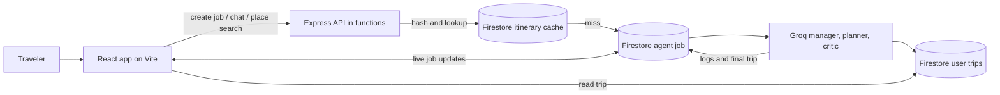

# vac-ai-tion

Plan a personalized trip, follow its generation, and edit the itinerary in one place.

> **Screenshot placeholder:** The image below is a temporary destination photo, not an app screenshot. Replace it with a screenshot of the landing page or generated itinerary. Capture a desktop view that shows the trip form or daily itinerary cards, then save it as `docs/images/app-screenshot.png` and update this image link.


[Live demo](https://vac-ai-tion.vercel.app) · [Source code](https://github.com/RythmaLakkady/vac-ai-tion)

[](https://github.com/RythmaLakkady/vac-ai-tion/actions/workflows/ci.yml)

## Why it exists

Trip planning often means gathering ideas across maps, travel sites, and notes, then arranging them into a workable daily plan. vac-ai-tion brings those steps into a single app and lets travelers review and adjust an AI-generated itinerary.

## Features

- **Generate a tailored itinerary:** Set a destination, trip length, budget, party size, travel style, and other preferences to receive a structured plan.
- **See generation progress:** Follow job status and orchestration logs as they update in Firestore, rather than waiting on a single long browser request.
- **Review and edit a trip:** View stops by day, reorder activities, and use map and itinerary feasibility views to assess the plan.
- **Keep trips and share them:** Save trips to a profile and create a public sharing link for an itinerary.
- **Explore destinations:** Search for places with autocomplete and view destination information alongside trip planning.
- **Compare estimated options:** Review ranked flight, hotel, and ticket results. The current backend comparison endpoint returns mock vendor data; these are not live quotes.

## Tech stack

| Area | Technologies and role |
| --- | --- |
| Frontend | React 18 and Vite for the single-page app; React Router for routes; Tailwind CSS and Framer Motion for styling and transitions. |
| Backend | Node.js, Express, and Firebase Cloud Functions expose API endpoints. Groq handles itinerary planning and chat requests. |
| Data and identity | Firebase Authentication manages sign-in; Cloud Firestore stores trips, jobs, progress logs, and itinerary cache entries. |
| Maps and place search | Leaflet/React Leaflet renders maps. LocationIQ provides place autocomplete, with OpenStreetMap Nominatim as a fallback. |
| Hosting and tooling | Vercel configuration serves the frontend; Firebase configuration supports functions and Firestore rules. ESLint, Vitest, Testing Library, and Jest are present in the repository. |

## Architecture

The React client submits trip inputs to the API. On a cache miss, the API creates a Firestore job and starts the manager → planner → critic workflow. The client listens to that job document for progress and reads the saved trip when generation finishes. A matching cache entry can return an existing itinerary instead.



The client defaults to the API URL in `src/service/config.js` (`https://vac-ai-tion.onrender.com`). The repository also contains a Firebase HTTPS-function export and a local Express entry point. A deployed backend URL and its credentials are required for API-backed features.

## Getting started

### Prerequisites

- Node.js 20 (the CI workflow uses Node 20; the functions package requires Node 18 or newer)
- npm
- A Firebase project and its web API key
- Access to a running vac-ai-tion API for trip generation, chat, and place search

No `.env.example` or dependency lockfile is checked in. Create a root `.env` file and set the values your setup needs:

```env
VITE_FIREBASE_API_KEY=your_firebase_web_api_key

# Optional: point the client at a different API. Defaults to the URL in src/service/config.js.
VITE_FUNCTION_URL=https://your-api.example.com

# Optional: use the configured Firebase Functions emulator instead.
# VITE_USE_LOCAL_EMULATOR=true

# Optional: enables a direct LocationIQ autocomplete fallback in the browser.
# VITE__LOCATION_IQ_API_KEY=your_locationiq_api_key
```

Keep server credentials such as `GROQ_API_KEY`, `LOCATION_IQ_API_KEY`, and Firebase Admin credentials on the backend; do not put them in `VITE_` variables. The Firebase web key is used by the client SDK. Configure authentication and Firestore for the Firebase project before signing in.

```bash
git clone https://github.com/RythmaLakkady/vac-ai-tion.git
cd vac-ai-tion
npm install
npm run dev
```

Vite prints the local development URL. In another terminal, run the available checks and production build:

```bash
npm test -- --run
npm run lint
npm run build
```

To install the backend dependencies separately, run `npm --prefix functions install`. The functions package has a Jest test script (`npm --prefix functions test`); the GitHub Actions workflow currently runs the root lint, test, and build scripts only.

## Engineering highlights

- **Asynchronous workflow:** The `/create-job` endpoint records a job and returns a job ID; the client subscribes to Firestore updates. This separates the long-running model workflow from the initial request.
- **Bounded validation loop:** A manager drafts a strategy, a planner formats an itinerary, and a critic checks it against constraints. The planner can retry up to three times with critic feedback.
- **Request reuse:** The backend normalizes selected request fields, hashes them with SHA-256, and checks Firestore before starting a new generation.
- **Data access rules:** `firestore.rules` restricts several user-owned collections to their authenticated owner and makes job/cache writes server-only. Public shared-trip reads are separately allowed by the rules.
- **Automated checks:** The repository includes Vitest/Testing Library tests, a Jest backend test, and a GitHub Actions workflow configured to lint, test, and build on pushes and pull requests to `main`. The latest recorded CI run did not reach these checks: it stopped because the repository has no npm lockfile for `npm ci`.

## Challenges and decisions

- **Long model calls:** The API creates a job before generation and stores status/log updates in Firestore. This keeps the interface responsive and gives it a progress source while work continues.
- **Model output can miss constraints:** The workflow separates strategy, structured generation, and critic review, and limits retries to three. If the critic itself errors, the current implementation accepts the parsed itinerary rather than failing the whole job.
- **Avoiding repeated inference:** The Firestore cache reuses generated trips for requests with the same hash. The current hash includes destination, days, budget, and travelers only; it does not include every trip preference, such as origin or travel style, so those requests can collide. Treat cache matching as a known limitation, not a guarantee of identical trip inputs.

## Known limitations

- The price comparison endpoint currently creates mock vendor results from destination text. It does not retrieve live prices or availability.
- Cache identity omits some generation inputs, including origin and travel style. Review `functions/src/cacheUtils.js` before relying on cache results.
- The README's local setup has not been validated in a fresh environment. The repository has no lockfile, and the latest CI run fails during `npm ci` before lint, tests, or build can run. Install and verify dependencies after adding a lockfile.
- There is no `LICENSE` file in the repository, so reuse terms are not specified.

## Author

- **Name:** Rythma Lakkady (GitHub account: [@RythmaLakkady](https://github.com/RythmaLakkady))
- **Role:** Not specified in the repository
- **Portfolio / LinkedIn:** Not provided

## License

No license file is present. The project does not currently specify a license.
