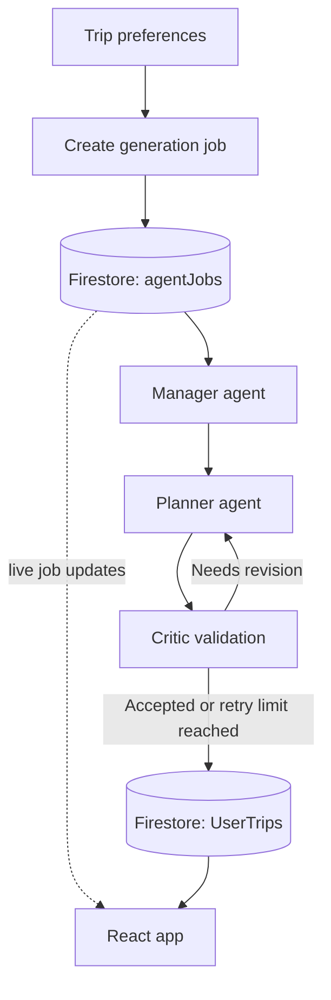

# vac-AI-tion

<p align="center">
  
</p>

<h3 align="center">Plan less. Explore more.</h3>
<p align="center">
  An AI-powered travel planner that turns trip preferences into editable, day-by-day itineraries — with live generation progress, route maps, and budget-aware planning.
</p>

<p align="center">
  <a href="https://vac-ai-tion.vercel.app"><strong>Open the app ↗</strong></a>
  &nbsp; · &nbsp;
  <a href="https://github.com/RythmaLakkady/vac-ai-tion">View source</a>
</p>

<p align="center">
  
  
  
  
</p>

---

## The experience

Start with the details that shape a trip — destination, duration, travelers, budget, and travel style. vac-AI-tion generates a structured itinerary in the background, shows the work as it happens, and lets travelers refine the plan.

<!-- Replace these with real product captures when available. -->
<p align="center">
  
</p>

## What it does

| Plan | Explore | Make it yours |
|---|---|---|
| Generate multi-day trips from traveler preferences | View places and routes on an interactive map | Reorder activities across days with drag-and-drop |
| Account for budget, travel style, saved places, and trip details | Follow agent progress as the itinerary is generated | Recalculate day-level totals and route details after edits |

**More than a prompt and a response.** The generation flow uses a Manager → Planner → Critic sequence. The Manager outlines the trip strategy, the Planner structures the itinerary as JSON, and the Critic checks key constraints. Failed validations can feed back into the Planner for another attempt, with a bounded retry limit.

## How generation works



The API creates a job and returns a response while the client listens to Firestore for status and progress updates. Repeated requests can be served from a Firestore cache using a SHA-256 hash of normalized trip inputs.

## Built with

| Layer | Technologies |
|---|---|
| Frontend | React 18, Vite, Tailwind CSS, React Router |
| Interaction & maps | @hello-pangea/dnd, Leaflet, React-Leaflet, Framer Motion |
| Backend | Node.js, Express, Firebase Cloud Functions |
| AI | Groq API — agent orchestration and structured itinerary generation |
| Data & auth | Cloud Firestore, Firebase Authentication |
| Testing & delivery | Vitest, React Testing Library, ESLint, GitHub Actions |
| Hosting | Vercel (frontend), Render / Firebase Functions (API deployment paths) |

## Engineering decisions

- **Asynchronous generation:** Long-running itinerary generation is separated from the browser request. A job document tracks status and logs, and the UI receives updates through Firestore listeners.
- **Bounded planner–critic loop:** The orchestrator allows up to three planner attempts. The Critic checks duration, activity count, hotel/flight constraints, and JSON completeness; on a failed check, its feedback is included in the next planning prompt.
- **Deterministic caching:** Normalized destination, duration, budget, and traveler count are hashed with SHA-256. A matching cache entry avoids another generation run.
- **Graceful location fallback:** Location search is designed to use LocationIQ and fall back to OpenStreetMap Nominatim where supported.
- **Public-trip privacy:** Shared itinerary views are intended to expose a read-only, sanitized representation rather than private profile information.

## Run locally

### Requirements

- Node.js 20+
- npm
- A Firebase project with Authentication and Firestore configured

### Setup

```bash
git clone https://github.com/RythmaLakkady/vac-ai-tion.git
cd vac-ai-tion
npm install
npm run dev
```

Configure the required Firebase client settings and backend service URL in your local environment. Keep private API credentials on the server: **do not put Groq or other secret keys in `VITE_*` variables**, because Vite embeds those values in browser-facing assets.

### Checks

```bash
npm run lint
npm test -- --run
npm run build
```

## Current limitations

- Flight, hotel, and activity price comparisons use heuristic mock vendor estimates, not live booking-provider inventory.
- The cache key currently omits travel style and some personalization fields; equivalent cache hits can therefore ignore those differences.
- Public shared trips are read-only; collaborative multi-user editing and conflict resolution are not implemented.
- Map tiles and trip retrieval require an internet connection.

## Project

Built by **Rythma Lakkady**.

[GitHub](https://github.com/RythmaLakkady) · [LinkedIn](https://www.linkedin.com/in/rythma-lakkady-1725852a2/) · [Portfolio](https://rythmalakkady.vercel.app/)

[MIT License](LICENSE)
